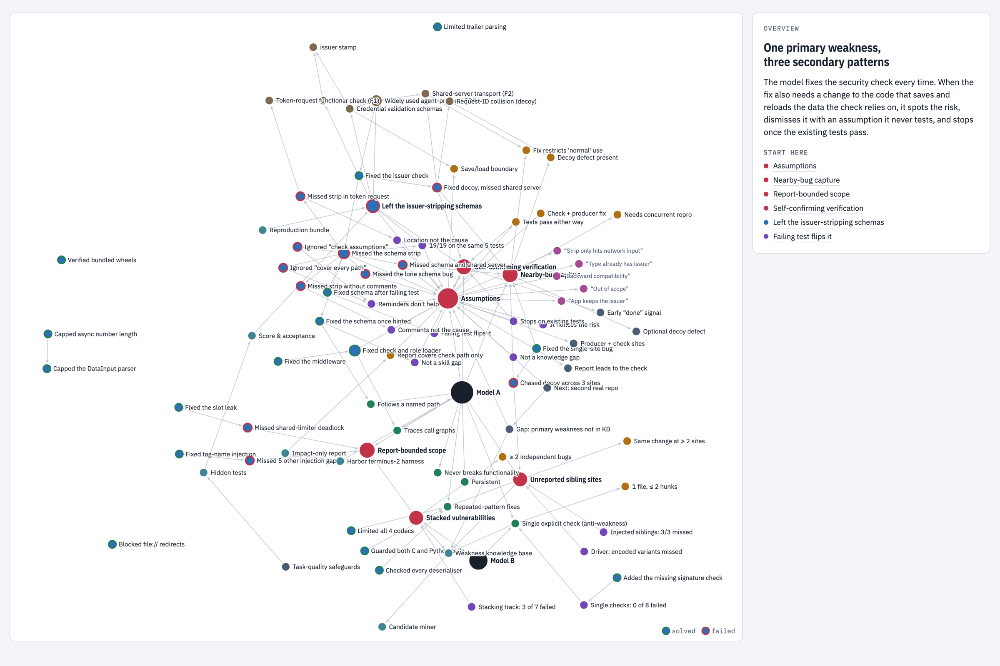
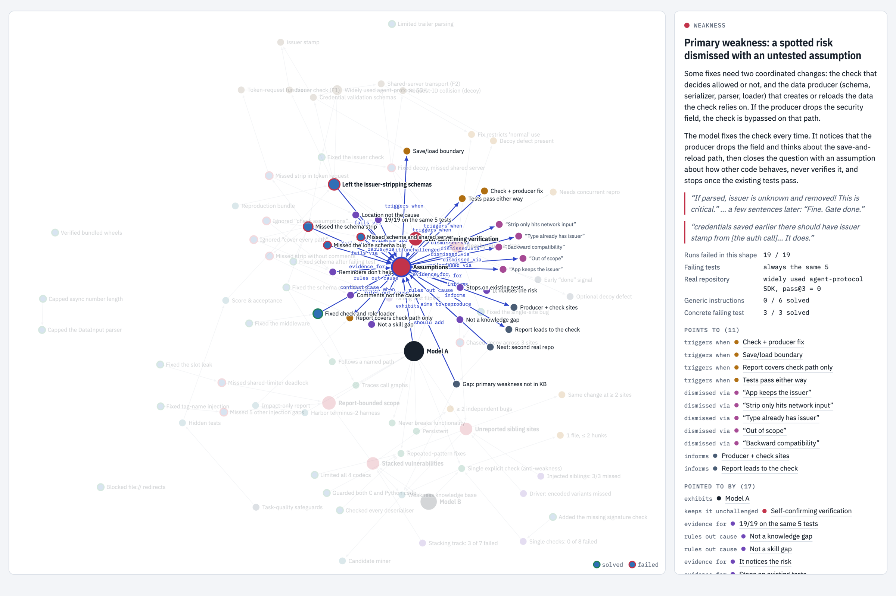
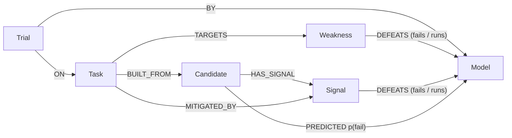
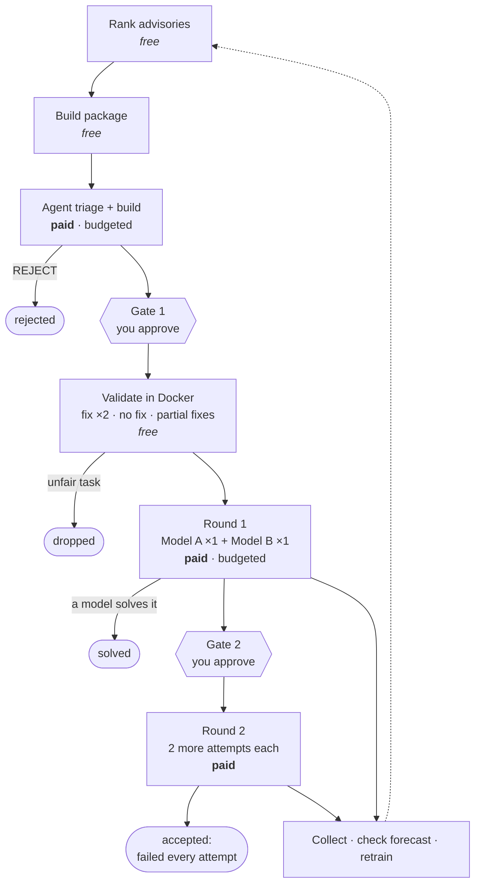

<div align="center">

# Vanguard

### Failure intelligence for LLM coding agents

**A self-improving knowledge graph that predicts which real-world security fixes an AI coding agent will fail, before you spend anything running it.**

[](#quick-start)
[](#quick-start)
[](#tested-end-to-end)
[](#what-it-does)

[**Explore the interactive knowledge graph →**](https://YOUR-USERNAME.github.io/YOUR-REPO/)

<a href="https://YOUR-USERNAME.github.io/YOUR-REPO/">
<picture>
  <source media="(prefers-color-scheme: dark)" srcset="docs/assets/graph-overview-dark.png">
  
</picture>
</a>

</div>

---

## Why this exists

Benchmark tasks that strong coding agents actually **fail** are expensive to find. Most candidate vulnerabilities turn
out to be easy: you build the task, validate it, pay for the model runs, and the agent solves it. Teams burn weeks and
budget on tasks that teach them nothing.

Vanguard turns every run into knowledge. It records **why** agents fail (the weakness, the conditions that trigger it,
the evidence behind it) in a knowledge graph, learns from each outcome, and ranks thousands of real advisories by how
likely each one is to defeat a given model. Then it drives the whole pipeline from that ranking to a validated,
accepted task, with a person approving every step that costs money.

## What it does

| | |
|---|---|
| 🧭 **Maps failure** | A typed knowledge graph of models, weaknesses, trigger conditions, signals, candidates, tasks and trials. Outcome edges carry evidence counts, so the graph can answer *"what defeats Model A, and how often was that confirmed?"* |
| 🎯 **Predicts failure** | Scores every advisory in a pool (1,928 real advisories in about 12 seconds, at no cost) with each model's chance of failing, the reasons behind the score, and how much evidence supports it. |
| 🔁 **Learns from every run** | New results flow back into the graph automatically. The predictor retrains, logs its accuracy, and checks every forecast it made *before* a task ran against what actually happened. |
| 🛡️ **Builds fair tasks** | Scripted validation (the real fix must pass twice, no fix must fail, a partial fix must land in between, nothing may leak) catches unfair tasks before any model runs. |
| 🚦 **Spends only with approval** | Paid steps (an AI build agent, model runs) need an explicit flag and a budget. Two human gates sit in the loop, and a solved round stops all further spending on that task. |

## The knowledge graph

Every finding is a node, and every relationship is typed and backed by evidence. Click a weakness and the graph lights
up its trigger conditions, the reasons the model gave for dismissing the risk, the experiments that isolated the cause,
and the tasks that expose it.

<picture>
  <source media="(prefers-color-scheme: dark)" srcset="docs/assets/graph-detail-dark.png">
  
</picture>

**92 nodes · 125 typed relationships · 10 node types**: models, weaknesses, trigger conditions, evidence, dismissal
reasons, tasks (with a solved or failed ring), code entities, strengths, task-design implications and method.
The same graph ships as [`graph.json`](docs/graph.json) and as [`nodes.csv`](docs/nodes.csv) / [`edges.csv`](docs/edges.csv)
for your own tools.

The pipeline's machine graph uses the same model at scale (thousands of candidate advisories, every trial, every
prediction):



## What the research found

Studied on real open-source vulnerabilities and on controlled variants that put parts of real fixes back into healthy
code (about 66 graded runs):

> **Primary weakness: a spotted risk dismissed with an untested assumption.** When a fix needs two changes (the
> security check, and the code that saves and reloads the data the check relies on), the model fixes the check every
> time. It *notices* the second path, dismisses it with an assumption it never tests, and stops once the existing tests
> pass.

| Evidence | Result |
|---|---|
| Tasks in the target shape | **8 of 8 failed on every run**; pass@3 = 0 on a real, unmodified codebase |
| Asked directly about the bug, no agent | Explains it correctly **6 / 6**: not a knowledge gap |
| One sentence in the report naming the second path | Solved **3 / 3**: not a skill gap |
| Generic reminders ("check your assumptions", "cover every path") | Solved **0 / 6** |
| One visible failing test on the second path | Solved **3 / 3**: it follows evidence, not reminders |
| Runs that tested the dismissed path before stopping | **0 / 12** |

Three secondary patterns are mapped too: a nearby real bug that captures the model's attention, scope that stops at
what the report describes, and verification that only re-checks the path already fixed. The full write-ups are in
[`findings/`](findings/).

## How the loop works



Each `vanguard.py loop` call moves every candidate as far as it can go **without crossing a gate or spending money**.
State lives in the graph, so the loop can be interrupted and resumed at any point.

## Does the learning work?

Measured honestly: each repository's tasks are held out together, and the model is scored on tasks it never saw.

| Predictor | Brier score (lower is better) |
|---|---|
| Overall fail rate | 0.394 |
| Hand-tuned weights | 0.320 |
| **Vanguard, learned from outcomes** | **0.230** |

With an entire repository held out, it still gave the real task in the target shape an 84% chance of failure, and that
task did fail every run. Every `train` appends to an accuracy history, and every forecast made before a run is scored
against the result, so you can watch the predictor improve as tasks are added.

## Quick start

Python 3.9+ and nothing to install. Docker and the Harbor evaluation harness are needed only for
validation and model runs.

```bash
cd vanguard
cp -r private.example private      # then point paths.json at your data and models.json at your models
python3 vanguard.py doctor         # checks the machine, the data, Docker/Harbor and runs the test suite
python3 vanguard.py ingest         # build the knowledge graph from past tasks and runs
python3 vanguard.py train          # fit the predictor and report its held-out accuracy
python3 vanguard.py rank --top 25  # score every advisory; writes a shortlist with reasons and evidence
python3 vanguard.py loop --select 3   # start the loop (free: writes build packages only)
```

| Command | What it does | Cost |
|---|---|---|
| `ingest` · `train` · `rank` · `report` | Build the graph, learn, rank, report | free |
| `collect` · `watch` | Record new results, check forecasts, retrain | free |
| `validate TASK` · `review TASK` | Fairness checks; reviewer sign-off on manual items | free (local Docker) |
| `loop` · `loop status` · `approve` · `reject` | Drive candidates end to end | gated |
| `loop --build --max-builds N` | Run the build agent | **paid** |
| `loop --run-models --max-model-runs N` | Run model rounds | **paid** |
| `doctor` · `export` | Health check; dump the graph as JSON | free |

Full documentation: [`vanguard/README.md`](vanguard/README.md).

## Built to be trusted

- **Every result is accounted for.** Crashed trials, timeouts and runs on an outdated version of a task are excluded by explicit rules, and those rules reproduce every result in the original study.
- **Validation can't overstate a task.** A task reaches `pass` only when every automated check passes and a reviewer has signed off on every manual item. Reviews can't override automated results.
- **Proven on real infrastructure.** Run against real Docker and Harbor, validation independently reproduced a human finding: a partial fix closed every attack, so the task was dropped.
- **No wasted spend.** A crashed trial re-runs only the crashed attempt and keeps valid results. One loop at a time. Safe concurrent writes to the graph. Atomic saves.
- **Private by design.** The code names no real model or project. Real identities live in a git-ignored `private/` folder (or entirely outside the repository), with templates in `private.example/`.

### Tested end to end

25 automated tests (`python3 -m unittest discover -s vanguard/tests`) cover result parsing, the rules for which trials
count, the graph store, the learner, every validation verdict, and the **complete loop**, from ranking to an accepted
task, including a rejected build, a crashed trial and a model solving the task, using stand-ins for the build agent and
the harness.

## Repository layout

```
├── docs/                    interactive knowledge graph (served by GitHub Pages) + graph.json / CSVs + images
├── findings/                the research: failure analysis, results, weakness specs (anonymised)
└── vanguard/                the pipeline
    ├── vanguard.py          command line
    ├── knowledge_graph.py   SQLite graph store: nodes, typed edges, metrics, prediction history
    ├── ingest.py            builds the graph; decides which trials count
    ├── learner.py           logistic regression with priors; held-out evaluation
    ├── validate.py          static and Docker fairness checks
    ├── loop.py              the end-to-end state machine with gates and budgets
    ├── catalog.json         curated weaknesses and mitigations
    ├── private.example/     templates for model identities, paths and task tags
    └── tests/               unit and end-to-end tests with stand-in agent and harness
```

## Honest limits

- The predictor is young: about 32 labelled tasks from 13 repositories, and most failures come from a single
  repository. The shortlist says so per candidate ("evidence: N tasks, M repositories"). High scores backed by one
  repository are hypotheses to test, not findings.
- The second model has few labelled tasks, so its predictions mostly reuse the first model's evidence.
- The build agent and paid model rounds are wired in and tested with stand-ins, but have not yet been exercised with
  a real agent.

## Roadmap

- More models through configuration alone: each one gets its own column and its own runs.
- Detection rules for the secondary patterns, so the ranker can target them directly.
- A real-task holdout to move the primary weakness from *supported* to *proven*.

<div align="center">
<br>
<sub>Built with the Python standard library · Knowledge graph rendered with D3 · Diagrams by Mermaid</sub>
</div>
